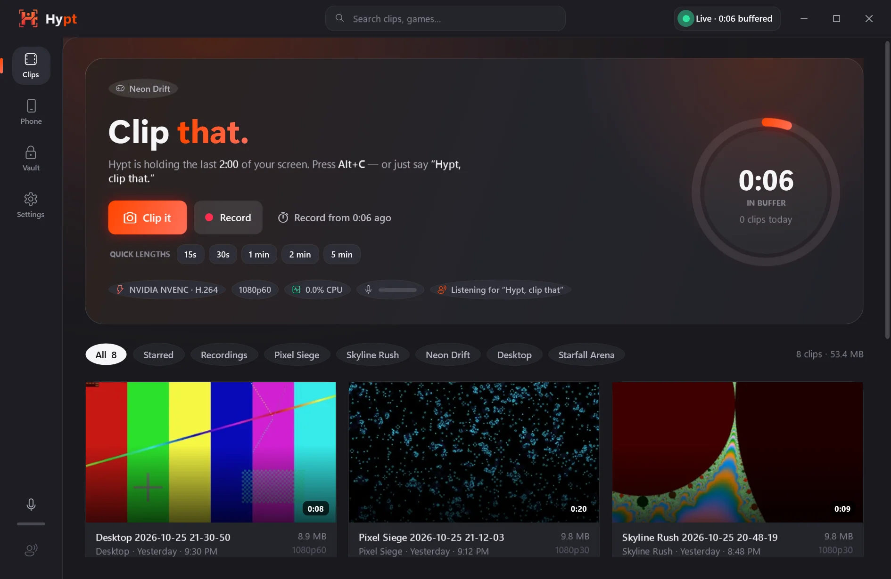
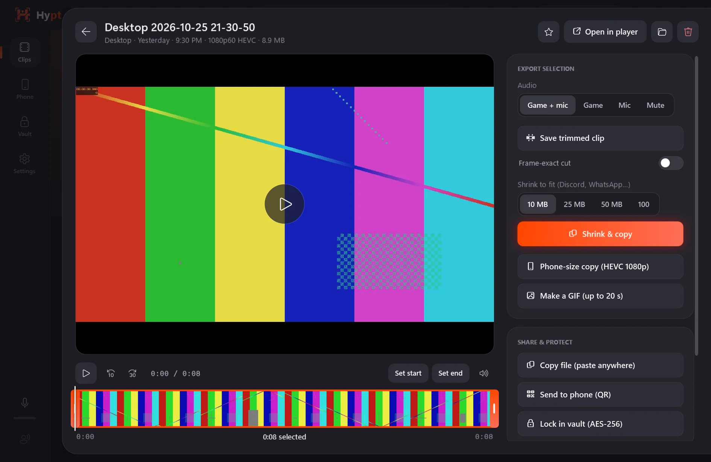
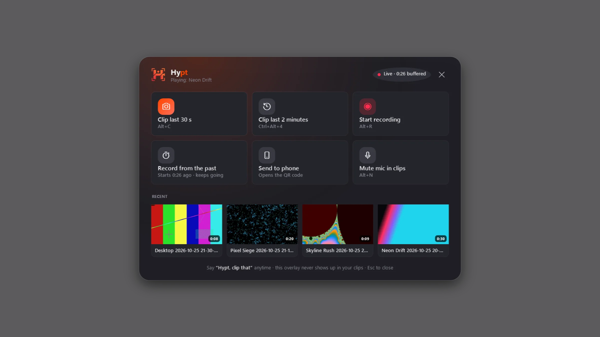

  

<h1 align="center">Hypt</h1>

<b>Say “Hypt, clip that.”</b> The lightweight game clipper for Windows — instant replay on your GPU, voice clipping, tiny files, and your clips on your phone in one scan.

  <a href="https://github.com/MSEVENDEV/hypt/releases/latest"><b>Download for Windows</b></a> ·
  <a href="https://msevendev.github.io/hypt/">Website</a> ·
  <a href="https://msevendev.github.io/hypt/design.html">Kinetic design system</a> ·
  <a href="https://github.com/MSEVENDEV/vyu">Vyu player</a>

## Why Hypt

ShadowPlay only works on NVIDIA. OBS is a studio, not a clipper. Medal wants an account and a cloud.
Hypt is a lightweight app that does one thing extremely well: **it keeps the last few minutes
of your screen ready, and saves them the moment you ask** — with a hotkey, from an overlay, or just by
saying so.

| | Hypt | NVIDIA Instant Replay | Medal | OBS replay buffer |
|---|:---:|:---:|:---:|:---:|
| NVIDIA · AMD · Intel GPUs | ✅ | NVIDIA only | ✅ | ✅ |
| Clip by voice (offline) | ✅ | – | – | – |
| “Clip the last 2 minutes” — several lengths at once | ✅ | one length | one length | one length |
| Record *from the past* (recording starts with your buffer) | ✅ | – | – | – |
| Hype detector (auto-clip when you yell) | ✅ | – | – | – |
| Privacy guard (password managers never end up in a clip) | ✅ | – | – | – |
| Encrypted vault for private clips | ✅ | – | – | – |
| Clips to your phone over Wi-Fi, no cloud, no account | ✅ | – | cloud upload | – |
| Shrink to 10 MB for Discord in one click | ✅ | – | ✅ | – |
| Separate game / mic audio tracks | ✅ | – | ✅ | ✅ |
| Open source | ✅ (MIT) | – | – | ✅ |

## Features

- **Instant replay that costs nothing.** The desktop is captured on the GPU (DXGI Desktop Duplication) and
  encoded by its video engine (NVENC, AMF or Quick Sync). On an RTX 4070 SUPER the whole thing uses
  **≈ 0.1 % CPU** and saves a clip in **≈ 0.5 s** — clips are stitched from 2-second segments, never re-encoded.
- **Voice commands.** “Hypt, clip that”, “Hypt, clip that shit”, “Hypt, clip the last two minutes”,
  “Hypt, start recording”, “Hypt, mark that”. Runs fully offline on a small built-in speech model (Vosk), tuned
  for accents (“Haybed, clib that” works) and for talking over game audio. Normal chat doesn't trigger clips.
  Settings → Voice check shows live what Hypt hears.
- **Clips that play everywhere.** H.264 by default, like NVIDIA — Windows' Media Player, Discord, WhatsApp and
  every phone open them. HEVC (≈ 40 % smaller) and AV1 are one click away; Hypt warns you when Windows needs a
  codec extension to play them. A live “≈ MB per minute” estimate in Settings.
- **Sync with NVIDIA, AMD & Medal.** Point Hypt at your NVIDIA, AMD Adrenalin or Medal clips folder: new clips land in the same game folders
  (`Desktop`, `VALORANT`…) with matching file names, and your existing clips show up in Hypt's gallery —
  thousands of them, loaded in seconds. Hypt never deletes a clip it didn't make.
- **Screenshots.** `Alt+F1` (NVIDIA's key) saves a PNG of the moment into the game's folder.
- **Updates.** When there's a new version, a pop-up offers **Later**, **Schedule** (when you close Hypt, or
  tonight at 3:00 — never mid-game) or **Update now & restart**. Downloads are checked against GitHub's SHA-256.
- **Hotkeys for every length.** `Alt+C` clips your default length, `Ctrl+Alt+1…5` clip 15 s / 30 s / 1 min /
  2 min / 5 min. `Alt+R` records, `Alt+M` drops a chapter marker, `Alt+H` opens the overlay.
- **Record from the past.** Start a recording that already contains everything in your buffer.
- **Hype detector.** Get loud on the mic (relative to your normal voice) and Hypt clips it for you.
- **Overlay that never shows up in clips.** Hypt's overlay and pop-ups are excluded from capture.
- **Post-roll.** Keep recording a second or two after the shortcut so the moment lands mid-clip.
- **Perfect sync.** Game sound and mic are re-clocked to the same clock as the video — measured within
  ~10–20 ms, and they never drift, no matter how long Hypt runs.
- **Separate tracks.** Game + mic mix, game only, mic only — export any of them later. Mic noise suppression.
- **Gallery with hover-scrub.** Clips are named after the game you were playing and filed per game.
  Hover a card to scrub through it.
- **Editor.** Trim (lossless or frame-exact), **Shrink to 10 / 25 / 50 / 100 MB** for Discord & WhatsApp,
  phone-size HEVC copy, GIF, copy-to-clipboard (paste straight into Discord).
- **Send to phone.** Scan a QR code and your clips open in the phone's browser — stream or save them over
  your own Wi-Fi. PIN-protected, one-time key, switches itself off when idle. No cloud, no account.
- **Vault.** Lock a clip with your password: it's encrypted with AES-256-GCM (PBKDF2-SHA256, 600k
  iterations, chunked and tamper-evident) and disappears from the folder, the gallery and phone sharing.
- **Privacy guard.** While KeePass, 1Password, Bitwarden & co. (or any app you add) are in front, that
  footage is destroyed from the buffer.
- **Storage that looks after itself.** A size cap that recycles Hypt's oldest clips — starred clips, NVIDIA's
  clips and your own videos are never touched.
- **Runs as administrator** (asks on launch), so it can capture elevated and anti-cheat games and read
  their names. **Start with Windows** uses a scheduled task, so there's no UAC prompt at every sign-in.
- **Stream Deck & macros.** `Hypt.exe --clip`, `--record`, `--marker`, `--overlay` control the running app.

  
  

## Install

1. Download `Hypt-x.y.z-win-x64.zip` from [Releases](https://github.com/MSEVENDEV/hypt/releases/latest) and unzip it anywhere.
2. Run `Hypt.exe` and accept the administrator prompt.
3. Play something and press **Alt+C** — or say **“Hypt, clip that.”**

Windows 10 2004+ or Windows 11, any GPU with a hardware encoder (falls back to CPU x264 otherwise).
Voice commands need the English speech pack (installed with English Windows; otherwise *Settings → Time
& language → Language → English (US) → Speech*). Clips are saved to `Videos\Hypt`.

## Privacy

Nothing leaves your PC unless you turn on phone sharing, and even then only devices on your network with
the one-time key or PIN can see your clips. Voice recognition is offline. No telemetry, no account.

## بالعربي

**هايبت (Hypt)** برنامج خفيف ومجاني لتسجيل لقطات الألعاب على ويندوز. يحفظ آخر دقائق من شاشتك
باستمرار (Instant Replay) على كرت الشاشة بدون ما يأثر على أداء اللعبة، ولما يصير شيء يستاهل تقول
**«Hypt, clip that»** أو تضغط **Alt+C** وتنحفظ اللقطة في نص ثانية.

- تسجيل بالصوت بدون إنترنت، وأكثر من طول للّقطة (15 ثانية إلى 5 دقائق) بأزرار مختصرة.
- حجم صغير (HEVC / AV1) وزر واحد يصغّر اللقطة إلى 10 ميغا للديسكورد.
- **انقل لقطاتك للجوال**: امسح كود QR وتفتح لقطاتك في متصفح الجوال على نفس الواي فاي — بدون سحابة وبدون حساب.
- **خزنة مشفّرة** (AES-256) للّقطات الخاصة، و**حارس خصوصية** يحذف أي لقطة فيها برنامج كلمات المرور.
- يطلب صلاحيات المسؤول عند التشغيل عشان يقدر يسجّل الألعاب المحمية.
- مشغّل الفيديو الشقيق: [Vyu](https://github.com/MSEVENDEV/vyu).

## License

Proprietary. Copyright (c) 2026 MSEVENDEV. All rights reserved. Pre-compiled binaries are free for personal, non-commercial use.
Designed with the [Kinetic design system](DESIGN.md).
